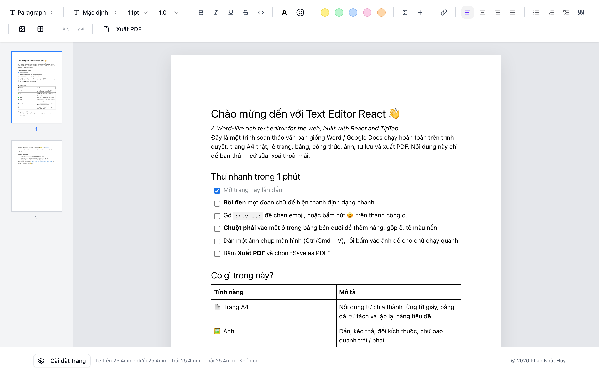

# Text Editor React

<div align="center">

[](https://react.dev)
[](https://www.typescriptlang.org)
[](https://vite.dev)
[](https://tiptap.dev)
[](LICENSE)
[](https://github.com/HuyPhan1232203/Text-editor-react/actions/workflows/ci.yml)

A Word-like rich text editor for the web, built with React and TipTap: an A4 page you type on, page margins, tables, math, autosave, optional real-time collaboration and PDF export.

**[Live demo →](https://text-editor-react-neon.vercel.app/)**



</div>

## Features

- **Slash menu**: type `/` to insert headings, lists, checklists, tables, images, formulas, code blocks, dividers or YouTube videos (filter by typing, arrow keys + Enter)
- **Find & replace**: `Ctrl/Cmd + F` (or `+ H` for replace) with highlighted matches, match case, replace one or all in a single undo step
- **Formatting**: bold, italic, underline, strikethrough, inline code, subscript, superscript, text color, highlight; smart typography (`--` → —, `(c)` → ©)
- **Typography**: font family, font size, line height, text alignment
- **Structure**: paragraph and headings H1–H6, bullet and numbered lists, checklists (pasting a Google Docs checklist keeps its checkboxes)
- **Tables**: insert tables, resize columns, add or delete rows and columns, merge and split cells, cell background color and vertical alignment, hide borders per table; long tables split between rows and repeat their header row on each page
- **Images**: paste, drop or upload images, resize them by dragging and wrap text around them (left / right)
- **Media**: links, emoji as plain text characters (picker or typing `:heart:`), inline math with KaTeX, YouTube embeds, code blocks with syntax highlighting (grammars lazy-loaded)
- **Drag & drop blocks**: grab the ⋮⋮ handle left of any paragraph, heading, table or image to move it
- **A4 pages**: content flows across separate A4 sheets like Word, portrait or landscape, margin presets and custom margins in mm
- **Header, footer and page numbers**: type in the top or bottom margin of any page; the text is shared by all pages, saved with the document, synced in collaboration, and included in the PDF export
- **Word import**: open a `.docx` (or drop it onto the page) with its headings, lists, tables, links, formatting and images; `mammoth` loads only when used
- **Sidebar**: page thumbnails (click to jump, lazy-rendered for long documents) or a document outline built from the headings
- **Status bar**: current page, word and character count
- **Welcome tour**: first-time visitors get an editable demo document that walks through the features
- **Autosave**: the document is kept in IndexedDB and page settings in localStorage, so a reload does not lose your work
- **Sharing without a server**: click **Share** to get a link; everyone with it edits the same document in real time, with named cursors and avatars of who is online. Peer-to-peer over WebRTC, end-to-end encrypted signaling ([details and limits](#sharing-and-collaboration))
- **PDF export**: works out of the box through the browser's print dialog ("Save as PDF"), with your page size and margins; optionally one-click download through a Puppeteer backend ([PDF-export-Puppeteer](https://github.com/HuyPhan1232203/PDF-export-Puppeteer))

- **English and Vietnamese UI**: picked from the browser language, switch any time in the footer

## Getting started

Requirements: Node.js 20+ and pnpm 10 or 11.

```bash
git clone https://github.com/HuyPhan1232203/Text-editor-react.git
cd Text-editor-react
pnpm install
pnpm dev
```

Open http://localhost:5173.

### PDF export

No setup needed: click **Xuất PDF** and choose **Save as PDF** in the print dialog. Only the page is printed, using the orientation and margins from page settings.

For a one-click download instead, run the optional backend and point the editor to it:

```bash
git clone https://github.com/HuyPhan1232203/PDF-export-Puppeteer.git
cd PDF-export-Puppeteer
docker build -t pdf-export .
docker run -p 3000:3000 pdf-export
```

Then copy `.env.example` to `.env`, set `VITE_PDF_API_URL=http://localhost:3000` and restart `pnpm dev`.

### Sharing and collaboration

Click **Share**, enter your name and **Create share link**. Your current document (with its header and footer) is copied into a new room and you get a link like:

```
https://your-host/?room=k3j9x2pq7m#key=4hd9…
```

Send it to the people you want to write with. Everyone in the room edits the same document, sees the others' cursors with their names, and appears as an avatar next to the Share button. **Leave room** takes you back to your private document, which is kept separately.

How it works, and what that means:

- **No server stores the document.** The app has no backend: peers sync directly over WebRTC ([y-webrtc](https://github.com/yjs/y-webrtc)), and each person's browser keeps a copy in IndexedDB. Someone who opens the link while nobody else is online gets the copy from their own last visit (or an empty document on a first visit). The latest version reaches them as soon as another member is online.
- **The link is the permission.** There are no accounts, and anyone with the full link can edit. The room key is in the URL fragment (`#key=…`), which browsers never send to servers; it encrypts the signaling, so the signaling server cannot read the content and people without the key cannot join, even if they guess the room name.
- **Signaling server.** Peers find each other through the public y-webrtc signaling server (`wss://y-webrtc-eu.fly.dev`). It only relays encrypted connection offers, but it is a free community service with no uptime guarantee; for production, run your own (`PORT=4444 npx -p y-webrtc y-webrtc-signaling`) and pass it in `signaling` where the `WebrtcProvider` is created (`src/components/tiptap/TipTapEditor/hooks/useEditorConfig.ts`).
- **Restrictive networks.** Without a TURN server, two peers behind strict corporate firewalls or symmetric NATs may not be able to connect. Add TURN servers through the provider's `peerOpts` if you need that.
- **Need a real backend?** For always-on persistence, permissions and many users, swap `y-webrtc` for a server provider such as [Hocuspocus](https://tiptap.dev/docs/hocuspocus) or [y-websocket](https://github.com/yjs/y-websocket); the editor side (Yjs + TipTap Collaboration) stays the same.

Older links with only `?room=<name>` (no key) still work, without encryption.

## Use the pagination in your own editor

The page layout engine is published separately as **[`tiptap-a4-pagination`](packages/tiptap-a4-pagination)** — a free TipTap 3 extension for A4 / Letter pages, table splitting and repeated header rows, without touching your document or CSS.

```bash
npm install tiptap-a4-pagination
```

See the [package README](packages/tiptap-a4-pagination#readme) for setup.

## Scripts

| Command | What it does |
| --- | --- |
| `pnpm dev` | Start the dev server |
| `pnpm build` | Type-check and build to `dist/` |
| `pnpm preview` | Preview the production build |
| `pnpm lint` | Run ESLint |
| `pnpm test` | Run the unit tests (Vitest) |

## Project structure

```
packages/
└── tiptap-a4-pagination/     # Pagination extension, published to npm
src/
├── i18n/                     # English / Vietnamese UI strings
├── components/
│   ├── tiptap/
│   │   ├── TipTapEditor/     # Editor shell, hooks (config, page settings, autosave)
│   │   ├── TextToolbar/      # Formatting toolbar and pickers
│   │   ├── tableTiptap/      # Table creation popover and cell toolbar
│   │   ├── header/           # Heading picker
│   │   ├── tiptap-node/      # Custom nodes (image upload)
│   │   └── tiptap-extension/ # Custom extensions
│   ├── PageSettingDialog.tsx # Orientation and margins
│   └── ui/                   # Radix-based UI primitives
├── config/                   # API endpoints
└── utils/                    # PDF export, style inlining, unit conversion
```

## Tech stack

React 19, TypeScript, TipTap 3 (ProseMirror), Yjs (y-webrtc, y-indexeddb), Radix UI, Tailwind CSS 4, SCSS, KaTeX, rolldown-vite.

## Roadmap

- DOCX export
- Split a single long paragraph across pages
- Comments in the margin
- Incremental pagination: re-measure only from the first changed block instead of the whole document on every edit

## Support & custom work

- ⭐ **Star the repo** if it's useful — it helps others find it
- 🐛 **Found a bug or a document that breaks the layout?** [Open an issue](https://github.com/HuyPhan1232203/Text-editor-react/issues)
- 💼 **Need a custom document editor?** I build and integrate TipTap / ProseMirror editors: pagination, PDF / DOCX export, Google Docs import, collaboration. Reach me at [huyphan1232203@gmail.com](mailto:huyphan1232203@gmail.com)

## Contributing

Issues and pull requests are welcome. Please run `pnpm lint`, `pnpm test` and `pnpm build` before opening a PR.

## License

[MIT](LICENSE) © Phan Nhật Huy
